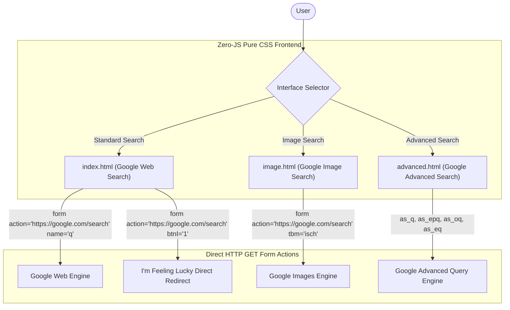

<div align="center">
  <h1>google-search-clone</h1>
  <p>Pixel-perfect frontend specification of Google Search, Image Search, and Advanced Search interfaces built with semantic HTML5 and responsive CSS3.</p>

  <p>
    <a href="LICENSE"></a>
    
    
    
    <a href="https://github.com/itsgoharrehman/google-search-clone/stargazers"></a>
    <a href="https://github.com/itsgoharrehman/google-search-clone/issues"></a>
  </p>
</div>

---

A responsive, pixel-accurate frontend implementation recreating the core user interfaces of Google Search, Google Image Search, and Google Advanced Search.

Engineered entirely with semantic HTML5 markup and modern CSS3 (Flexbox, CSS Grid, and custom variables) with zero JavaScript execution dependencies. The project faithfully replicates Google's native HTTP GET form submission workflows, directing search parameters directly to live Google endpoints.

---

## Architectural Principles and UI Architecture



---

## Implemented Pages and Parameter Specifications

| Page | File | Form Action | Key Query Parameters |
| :--- | :--- | :--- | :--- |
| **Google Search** | `index.html` | `https://google.com/search` | `q` (Search terms), `btnI=1` (I'm Feeling Lucky) |
| **Image Search** | `image.html` | `https://google.com/search` | `q` (Search terms), `tbm=isch` (Image mode) |
| **Advanced Search** | `advanced.html` | `https://google.com/search` | `as_q` (all words), `as_epq` (exact phrase), `as_oq` (any words), `as_eq` (none of these words) |

---

## Key Features

* **Zero-JavaScript Execution**: All search functionality operates entirely via standard HTML5 `<form method="GET">` mechanics.
* **Pixel-Accurate Typography and Layout**: Implements Google's exact font hierarchy, search bar box-shadow transitions, pill buttons, and responsive navbar alignment.
* **Advanced Search Grid**: Structured multi-input form replicating Google's four-tier search criteria with right-column contextual guidance.
* **Accessible and Semantic**: Structured with proper `<header>`, `<main>`, `<footer>`, and accessible ARIA attributes.
* **Lightweight**: Minimal asset footprint loading in single-digit milliseconds.

---

## Directory Structure

```
google-search-clone/
├── .github/
│   ├── ISSUE_TEMPLATE/
│   │   ├── bug_report.yml          # Structured bug report form
│   │   └── feature_request.yml     # Structured feature request form
│   ├── PULL_REQUEST_TEMPLATE.md    # Pull request review checklist
│   └── dependabot.yml              # Weekly automated npm scanner
├── advanced.html                   # Google Advanced Search implementation
├── image.html                      # Google Image Search implementation
├── index.html                      # Core Google Web Search interface
├── styles.css                      # Unified stylesheet for all three interfaces
├── package.json                    # Local dev scripts and tooling metadata
├── LICENSE                         # MIT License
├── SECURITY.md                     # Security policy and form action boundaries
├── CONTRIBUTING.md                 # Contribution guidelines
└── CODE_OF_CONDUCT.md             # Contributor Covenant v2.1
```

---

## Local Development

### Prerequisites

* Any modern web browser (Chrome, Firefox, Safari, Edge)
* Node.js v18+ (optional, for local HTTP static preview)

### Setup and Running

1. Clone the repository:
   ```bash
   git clone https://github.com/itsgoharrehman/google-search-clone.git
   cd google-search-clone
   ```

2. Launch local static server:
   ```bash
   npx serve .
   ```
   Or open `index.html` directly in your browser.

---

## Security Policy

See [SECURITY.md](SECURITY.md) for details regarding the static frontend security model and safe URL target invariants.

---

## License

This project is licensed under the terms of the [MIT License](LICENSE).
